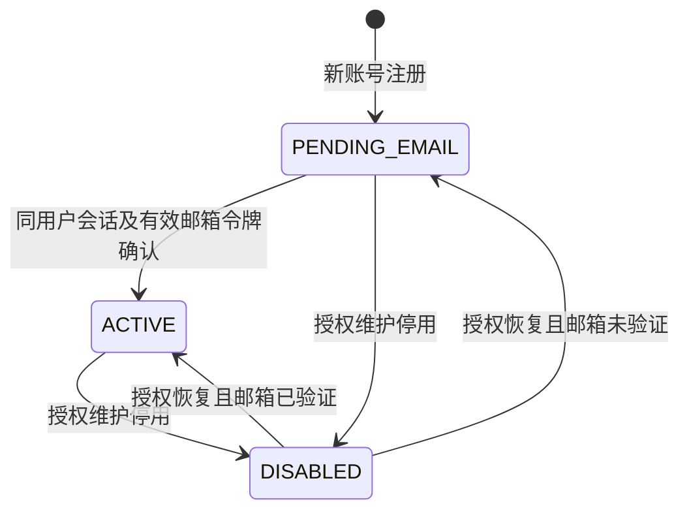

# LTSD 账号系统规格

本文为 LTSD（LastROWeb）账号系统的独立规格 v0.3，永久保存在项目的 `docs/superpowers/specs/2026-10-12-ltsd-account-system-design.md`。后续以项目内版本为准，不再向本地 Obsidian 维护账号规格。账号功能不依赖游戏交易、Stripe、支付宝或钻石方案。本次只迁移和修订文档，未实现账号代码、配置生产服务或发送邮件。

相关项目资料：[README](../../../README.md)、[部署说明](../../deployment.md)、[MySQL 迁移](../../mysql-migration.md)、[登记簿规格](2026-09-23-guestbook-design.md)。

## 1. 目标、已确认规则与当前项目事实

用户已确定的第一阶段需求：

- Email 注册、登录/退出、邮箱认证与重发、登录后修改密码、忘记密码重置、本人账号信息。
- 注册必须填写“昵称/主要游戏角色名”；首版为一个字段 `display_name`，不强制分别填两个名字。昵称可登录后修改，是用户声明的展示名，不是游戏身份绑定或所有权证明。
- 头像可选；用户在浏览器选择本机图片、交互式正方形裁剪并压缩为 WebP；API 接收 Base64，MySQL 保存纯文本 Base64。登录后可上传、替换及删除。
- 密码只限制 **5–256 个字符**，不加字符组合、常见密码拒绝列表、不同于旧密码或定期更换规则。密码处理仅在 Worker 执行。
- 服务端保存固定秘密的快速不可逆摘要；秘密通过 GitHub Actions Secret 注入 Worker Secret，不引入内存密集或大量迭代的密码库。
- 用户主键由数据库自增，首个新用户 **10000**。
- 登录 Cookie 与服务器会话默认有效 **30 天**；到期前真实访问自动续为从本次访问起 30 天，可持续续期，无额外 7 天绝对期限或 24 小时空闲期限。
- 所有新增 Worker 路径按免费版 **10 ms CPU** 上限设计，非安全图片处理交给浏览器，安全判断仍在服务端。

已只读确认当前仓库：生产是 Cloudflare Worker＋Hono API、Vite UI、MySQL 8（`mysql2`），不存在生产 D1 回退；资料位于 `apps/worker`、`apps/web`、`migrations/mysql` 和 `docs`。源码中已有上传源 Bearer 鉴权，它不是玩家账号系统，必须保留其边界。生产域名代码引用 `ltsd.ro`；账户实际套餐、生产密钥及邮件账户本次未进入后台核实。历史 agent 文档中的 D1 记录不能覆盖当前 README 与生产 MySQL 事实。

正文明确采用上述用户规则；头像 256×256、邮件供应商、文件大小、限流与资料长度是建议默认值。技术实现复用当前结构，不要求换认证平台、数据库或 UI 框架。成功标准为完整注册/验证/登录/资料/密码恢复流程可独立运行，既有公开页面继续可访问，账号 API 有本人授权与可撤销会话，免费 CPU 预算有实际测量证据。

## 2. 首版范围

| ID      | 必须交付的能力    | 说明                                     |
| ------- | ---------- | -------------------------------------- |
| AUTH-01 | Email 注册 | Email、密码、确认密码、必填昵称/主要游戏角色名、可选处理后头像；唯一账号和待验证状态 |
| AUTH-02 | Email＋密码登录 | 正常登录、错误提示、未验证账户的有限登录                   |
| AUTH-03 | 退出当前/全部会话  | 服务端撤销，不能仅清理前端状态                        |
| AUTH-04 | 邮箱验证与重发    | 验证链接、有期限、一次性、成功/失效/重发反馈                |
| AUTH-05 | 登录后修改密码 | 当前密码校验、5–256 长度与确认匹配、撤销旧会话；不额外要求新旧不同 |
| AUTH-06 | 忘记密码与重置    | 通用响应、邮件链接、设置新密码、撤销全部会话                 |
| AUTH-07 | 账号与资料页 | 本人 ID、Email、验证状态、注册时间、可编辑昵称/主要游戏角色名和头像 |
| AUTH-08 | 公共网站接入     | 登录状态、导航入口和受保护账号页面；原公开内容保持可用            |
| AUTH-09 | 必要安全和免费预算 | 服务端鉴权、CSRF、限流、原生低成本摘要、邮件恢复和 CPU 验证 |
| AUTH-10 | 昵称修改 | 登录后编辑本人展示名，不能为空，不要求唯一，不证明角色归属 |
| AUTH-11 | 头像设置 | 浏览器裁剪压缩、纯 Base64 存储、本人上传/替换/删除、独立读取 |

**本阶段范围外：** 游戏账号或角色绑定、机器人、物品、出售/购买/取消/提现、余额账本、实名/KYC、Stripe/支付宝、钻石充值、社交登录、手机短信、MFA/Passkey、自助换绑邮箱、账号删除、独立管理员门户和详细登录设备列表。可复用已有安全能力，但不为未来交易提前创建相关表和页面。

公开资料、物品数据库等既有页面是否要求登录，须遵循现有行为；本规格仅要求账号信息和安全操作受到保护。邮箱验证证明用户控制邮箱，不等于实名认证，也不等于 MFA。

## 3. 技术结构与兼容边界

沿用现有 Worker/Hono、Vite 和 VPS MySQL 8；不为账号引入 D1、Redis、Hyperdrive、HTTP 数据库代理或新的重型认证服务。依赖只用于确有必要的轻量功能；密码直接使用 Worker 原生 Web Crypto。浏览器图片编辑可使用现有组件或轻量裁剪 UI，解码/压缩由浏览器完成。

| 职责 | 位置 | 约束 |
|---|---|---|
| 表单、裁剪、缩放、WebP 编码、Base64 | 浏览器 | 非安全工作；最终字段和权限仍由 Worker 校验 |
| 密码摘要、会话/令牌、CSRF、本人授权 | Worker | 原生低成本操作，不能信任浏览器计算的密码摘要 |
| 用户、自增 ID、会话、令牌、头像和邮件任务 | MySQL 8 | 主键/唯一约束、参数绑定、原子更新与索引 |
| 验证/恢复通知 | Worker 通过 HTTPS 调用邮件服务 | 默认 Resend 免费套餐；小请求、小模板与单任务重试 |
| 导航、账号页面 | 现有 Vite UI | 复用布局、设计令牌和语言能力，不改变既有公开访问规则 |

统一用不可变数据库 `user_id` 关联业务数据。Email 是登录属性；昵称可修改且可重名，不充当鉴权键、唯一角色标识或外键。不可把玩家 Cookie 赋予现有上传源或管理员 secret 权限。

当前公开 API 的 CORS 中间件使用 `Access-Control-Allow-Origin: *` 且不带凭据；账号路由必须单独处理，不将通配符与 credentialed Cookie 混用，不改变原市场匿名缓存行为。Cookie 账号响应默认 `Cache-Control: no-store`，不得进入市场的公共响应缓存；头像的独立公开字节响应另定缓存规则。

## 4. 页面与交互

页面适配当前 Vite 路由；建议名称如下。

| 页面 | 内容 | 状态 |
|---|---|---|
| `/register` | Email、昵称/主要游戏角色名、密码及确认、可选头像裁剪预览 | 校验、处理中、受理、发送待重试、限流 |
| `/login` | Email、密码、注册/忘记密码入口 | 错误、受限登录、成功 |
| `/verify-email` | 检查邮箱、确认验证、重发入口 | 需登录、待验证、失效、已验证 |
| `/forgot-password` | Email 申请恢复 | 通用受理、限流、暂不可用 |
| `/reset-password` | 新密码及确认 | 链接有效/失效、提交、成功后登录 |
| `/account` | ID、Email、验证状态、注册时间、可编辑昵称、头像上传/替换/删除 | 正常、待验证、图片处理中、保存失败/成功、会话过期 |
| `/account/password` | 当前密码、新密码及确认 | 错误、成功后重新登录 |

首版只有一个必填展示名，标签为“昵称/主要游戏角色名”，提示可以填写常用游戏角色名。默认去掉两端空白后为 1–32 个 Unicode code point，不能全空白；允许重名、空格和正常标点。按纯文本安全输出，不能把昵称当 HTML，也不把文字变更当作角色绑定变更。

头像在注册时可跳过，默认显示站点通用头像或昵称首字占位；已有用户登录后可设置。保存失败保留原资料/头像及用户当前编辑内容，不能提前把 UI 当作已经入库；替换成功覆盖旧数据，不保留多份图片历史，审计只记录动作与版本。

表单可键盘操作、移动端裁剪、密码显示/隐藏、粘贴与自动填充，提交中防重复。客户端只做密码长度/确认检查，不做密码摘要运算。页面使用现有语言和视觉样式；登录返回路径仅限站内，含令牌页面不加载泄露令牌的第三方分析。

登录状态恢复后执行 §7.3 的会话续期，显示最新昵称和头像版本；公开页面即使会话过期也继续可用，不强迫访客登录。

## 5. 功能流程

### 5.1 注册

1. 校验 Email、密码 5–256 长度和确认匹配、必填展示名及可选处理后头像；Worker 独立校验大小、格式和字段白名单。
2. 规范化登录 Email，在 MySQL 唯一约束下创建 `PENDING_EMAIL` 账号并保存初始资料/可选头像；ID 使用数据库 AUTO_INCREMENT。注册竞争只能得到一个账号，客户端不能指定 ID。
3. 保存安全密码材料和验证动作，可靠安排邮件投递；不把投递成功当作邮箱验证。
4. 跳转待验证页面，说明需检查邮箱并登录后完成验证。注册请求本身不自动建立登录会话。
5. 对已占用 Email 不覆盖密码、不重新创建用户、不自动绑定新身份；公开响应与正常受理保持一致，引导用户登录或忘记密码。

统一受理提示示例：“如果该邮箱可用于注册，你会收到验证邮件。已有账号请登录，忘记密码可申请重置。”结构有效的新/已存在 Email 都返回同类响应，不通过状态码、用户 ID、Cookie 或跳转泄露存在性。格式错误可具体提示，基础设施整体失败可提示稍后重试。

若账号创建成功但邮件未投递，账号仍保持待验证；允许凭注册密码有限登录后重发，避免重试造成第二个账号。匿名重复注册请求不得无条件反复给已有账号发送邮件。

### 5.2 登录与退出

校验 Email＋密码后按服务端账号状态发放会话。不存在的账号、密码错误、禁用账号统一显示“邮箱或密码不正确，或账号暂不可用”，响应不暴露具体内部原因，并做合理的耗时均衡。

`ACTIVE` 获得正常本人账号权限；`PENDING_EMAIL` 只获得受限会话，可查看本人信息、修改本人昵称/头像、请求/完成验证、续期和退出。只有凭据校验成功后，才显示该本人账号尚未验证。公开内容仍可浏览。

登录成功必须产生新的会话凭据，防止会话固定。退出当前会话在服务端撤销该会话并清 Cookie；退出全部会话撤销该用户所有会话，包括当前会话。重复退出为安全的幂等结果，不因前端显示已退出而保留后端权限。

登录核验密码到创建会话之间，须确保使用的凭据版本没有变化；并发改密/重置成功后，不能用先前已校验的旧密码快照创建新版本会话。全部退出、会话轮换和停用须使用原子版本或等效机制，防止进行中的旧身份请求重新创建被撤销的会话。

### 5.3 邮箱验证与重发

验证链接打开确认页；**GET 不直接修改账号或消费令牌**，避免邮件安全扫描/预览自动触发。用户提交确认时，由服务端核对令牌用途、用户、Email 快照、有效期、撤销/使用状态和凭据版本。

确认还要求当前受限/正常会话属于同一用户；无会话则先登录，其他账号则提示使用正确账号。保留有效链接的安全上下文，登录跳转不泄露令牌。这样邮箱所有者不会仅因点击别人代注册的邮件，就激活攻击者已知密码的账号。若本人不知道该注册密码，可以通过自己的邮箱重置，再登录并请求新验证链接。

验证成功在一次事务/等效原子操作中消费令牌、写入 `email_verified_at`、将账号变为 `ACTIVE` 并使同用户其他验证令牌失效。现有会话需要轮换或要求重新登录；本规格默认轮换当前会话，其他会话仍按服务端最新状态校验，不保留静态“未验证/已验证”授权快照。

默认链接有效期 24 小时。受限登录用户可重发，受限于冷却和发送额度；重发只发给账号登记邮箱，不能输入另一个目标邮箱。重发可保留同凭据版本下未过期旧链接，避免邮件乱序和投递延迟造成误失效；任一成功后全部失效。已验证用户请求重发安全返回“已验证”，不发送无用邮件。

链接无效、过期、已用或已撤销统一提示“链接已失效，请登录后重新申请”。重复确认不可产生第二次状态变化；若本人已经验证，可显示本人当前的已验证状态，但不能把无效令牌当作新的验证凭据。

### 5.4 登录后修改密码

仅 `ACTIVE` 用户可操作；需要当前密码、新密码与确认密码，并校验 CSRF。错误当前密码不改变凭据或会话；新密码只校验 5–256 长度与确认匹配，允许与当前密码相同，不加复杂度或弱密码拒绝规则。

成功时原子更新密码、递增凭据版本、使全部旧会话和旧验证/重置动作失效，并可靠安排密码变更通知邮件。本规格默认清理当前 Cookie、要求重新登录，不保留任何原会话。邮件失败不回滚已经成功的密码变更，应记录并重试通知。

凭据版本或等效机制必须同时防止并发改密和旧请求覆盖新密码；不能仅在请求开始检查一次。两个并发请求最多一个以原密码快照成功，另一个重新认证。用户不会从邮件收到明文新密码。

### 5.5 忘记密码与重置

1. 用户提交 Email；已注册/未注册/禁用账号返回同类受理结果，不显示账号存在性。
2. 对可恢复账号生成 `RESET_PASSWORD` 令牌并可靠发送邮件；待验证账号也可恢复，防止邮箱被预注册长期占用。禁用账号不通过重置恢复权限。
3. 打开链接只显示重置表单，不消费令牌；用户提交新密码后原子核验和消费令牌。
4. 成功更新密码、递增凭据版本，使全部旧会话、其他重置令牌和旧验证令牌失效；通知邮箱密码已重置。
5. 不自动登录，转到登录入口。待验证账号仍待验证，用户登录后请求新的验证邮件；重置与邮箱验证不是同一个动作。

默认重置有效期 30 分钟。请求邮件本身不冻结账号、不改密码、不撤销正常会话，也不因后一次匿名请求立即撤销前一次有效重置链接，避免他人用反复申请阻止恢复；任一成功重置后其他链接全部失效。重复/并发提交最多一次成功，旧链接不能在后续改密后继续使用。

统一提示：“如果该邮箱对应可恢复的账号，你会收到重置邮件。”失效页提供重新申请入口；新密码格式不合格时不消费有效令牌。重置接口不接受请求者指定的其他 `user_id` 或 Email 作为授权依据。[OWASP：密码恢复的单次令牌、通用响应及会话撤销](https://cheatsheetseries.owasp.org/cheatsheets/Forgot_Password_Cheat_Sheet.html)

## 6. 身份状态与授权



这是逻辑状态模型；若框架使用多个字段，保持同等语义即可。`ACTIVE` 必须有有效邮箱验证记录；禁用状态优先于邮箱验证，不因旧验证邮件、重置密码或恢复会话绕过。账号停用/恢复复用已有授权维护入口，不要求本期建设新后台；没有现有入口时在维护说明中记录受控操作方式。

| 能力 | 未登录 | 待验证的本人会话 | 已验证的本人会话 | 禁用/失效会话 |
|---|---|---|---|---|
| 现有公开页面 | 允许 | 允许 | 允许 | 允许 |
| 注册、登录、申请密码恢复 | 按限流允许 | 前端可引导账号页；恢复请求仍按公开安全规则 | 同左 | 允许尝试，不能恢复禁用权限 |
| 查看本人基本信息 | 拒绝 | 允许 | 允许 | 拒绝 |
| 重发/确认邮箱验证 | 拒绝；可先登录 | 允许，确认另需有效同用户令牌 | 返回本人已验证状态 | 拒绝 |
| 登录后修改密码 | 拒绝 | 拒绝，提示先验证；仍可走邮箱恢复 | 允许，另需当前密码和 CSRF | 拒绝 |
| 修改本人昵称/头像 | 拒绝 | 允许，另需 CSRF；不授予其他权限 | 允许，另需 CSRF | 拒绝 |
| 当前/全部退出 | 无会话时安全幂等 | 允许 | 允许 | 安全清理，不授予其他权限 |

鉴权至少提供 `require_authenticated` 与 `require_verified_account` 的等效能力，并能得到不可变当前用户 ID。每次受保护请求检查最新账号/会话状态或可立即撤销的版本，不仅靠前端隐藏按钮。无权限时不能返回其他用户数据。

## 7. 身份、密码、滚动会话与头像

### 7.1 用户 ID 与 Email

新用户表使用 MySQL 自增整数主键，建议 `BIGINT UNSIGNED AUTO_INCREMENT`，建表初始 `AUTO_INCREMENT=10000`。第一条成功插入的新账号为 10000；随后递增，失败/回滚造成缺号正常，不追求连续。不得用 Worker 内存计数或 `MAX(id)+1`，不得接受用户传入 ID。若已有用户表，保留已有 ID 和外键，只把未来起点设为至少 10000/现有序列的较高值；不能为满足起点重排用户。

API 的 ID 统一为十进制字符串，例如 `"10000"`，避免 BIGINT 超过 JavaScript 安全整数后的精度问题；数据库仍是真实整数。公开 ID 不保密，所有修改都从服务端会话取得本人 ID，不能依靠 ID 不可猜测阻止越权。

使用成熟 Email 解析能力；登录规范化值唯一，产品约定不区分大小写，去掉两端空白并统一域名表示，保留有效投递地址。注册/登录/恢复/限流同一规则；不合并 Gmail 点号或 `+tag`。首版常规 ASCII local-part，国际化域名用成熟库处理。Email 暂不允许换绑。资料 API 只允许展示名等白名单，不能写验证状态、权限、凭据版本或别人的 ID。

### 7.2 密码与固定秘密

**用户明确规则：** 密码为 5–256 个 Unicode code point，前后端计数一致。允许 Unicode、空格、数字/字母/标点，不 trim、不大小写转换、不截断；没有大小写/符号组合、弱密码拒绝列表、密码历史、新旧不同、周期改密或外部泄露查询。确认密码必须匹配只是避免输入错误。超过长度在计算摘要前拒绝。输入须为可原样 UTF-8 编码的有效 Unicode；孤立 UTF-16 surrogate 属于编码错误，拒绝而不静默替换为 U+FFFD，不改变合法 Unicode、emoji、空格或 U+FFFD 的密码规则。

本项目采用 **原生 HMAC-SHA-256＋服务端固定秘密＋每账号随机盐**。用户称“固定盐”的 GitHub Secret，在此作为不存入数据库的秘密 pepper；每账号额外 16 字节随机盐成本很小，不增加用户操作。方案为：

```text
scheme = hmac-sha256-v1
key = Worker Secret AUTH_PASSWORD_SECRET
message = UTF8("ltsd-password-v1" + NUL) || 16-byte user_salt || UTF8(password)
digest = HMAC-SHA-256(key, message)
```

随机盐用 `crypto.getRandomValues`；导入密钥、计算及验证只在 Worker 使用 `crypto.subtle` 的原生 HMAC，验证用 `subtle.verify` 或等效安全比较。数据库保存 scheme、随机盐、密钥版本和摘要，不保存固定秘密或可逆密码。不存在的 Email 可用固定虚拟盐执行同等单次校验，防止明显的认证耗时差异；限流在密码计算前进行。随机会话/动作令牌的摘要与密码方案按用途分开。

不引入 Argon2/bcrypt/scrypt 库，不运行高次数 PBKDF2，不用 MD5/SHA-1，不在浏览器预哈希，也不声称异步 Web Crypto 完全不计 CPU；整体请求仍需实测。

**性能取舍：** 快速摘要并不是密码专用慢哈希；“不可逆”不保证弱密码无法被猜出。数据库与固定秘密同时泄露时，该方案的离线猜测防护明显弱于慢哈希。这是采用用户给定 10 ms/简单密码目标的记录，不是强密码存储最佳实践或 NIST 合规声明。[OWASP 对快速摘要与 pepper 的说明](https://cheatsheetseries.owasp.org/cheatsheets/Password_Storage_Cheat_Sheet.html)

GitHub `production` Environment 中保存 `AUTH_PASSWORD_SECRET`，部署工作流沿现有做法通过标准输入写入同名 Worker Secret；不能放进 YAML 明文、TOML `vars`、`VITE_*`、前端 bundle 或日志。仅配置 GitHub Secret 不能让运行中的 Worker 自动读取它。[Cloudflare Worker Secrets](https://developers.cloudflare.com/workers/configuration/secrets/)

密钥建议一次生成 32 字节随机值并安全保存，导入为 HMAC 密钥；不是从网站名生成，也不在每次部署更换。记录 `password_key_version`；丢失密钥无法恢复现有密码。未来轮换需暂保旧版本密钥并在登录/改密时升级或走邮箱恢复，不能换 Secret 后声称所有旧密码仍可验证。可按 isolate 缓存导入的 CryptoKey，不能缓存用户密码或跨配置错误复用密钥。

### 7.3 30 天滚动会话

采用 MySQL 可撤销的随机 Cookie 会话，原生随机令牌建议 32 字节，数据库只存摘要。默认 `Max-Age=2592000`（30×24×60×60 秒），服务器初次 `expires_at=now+30天`。Cookie 为 `Secure; HttpOnly; SameSite=Lax; Path=/`，同源时默认不加 Domain；适合时使用 `__Host-` 前缀。无 7 天绝对期限、无额外 24 小时空闲失效、无隐藏的累计最大存活期。

每次用户在未到期前重新打开/恢复访问网站，浏览器发一次受 CSRF/同源保护的 `POST /api/v1/auth/session/refresh`；服务器检查 Cookie 摘要、最新账号/凭据状态、未撤销且 `expires_at>now`，原子更新为 `now+30天` 并重新设置 30 天 Cookie。持续真实访问可持续续期；连续 30 天未有效访问则重新登录。不能只改浏览器 Cookie 而不改服务器期限，也不能只延长数据库而忘记 Cookie。

首版“刷新”指会话资格及 Cookie 期限刷新，默认不在每次页面访问更换随机值，以免并发页面相互使令牌失效；登录、邮箱验证身份升级时必须轮换随机值，改密/恢复/全部退出/停用时立即撤销。若实现选择每次刷新都轮换，必须另外解决并发与旧响应覆盖，并有相应验收，不能牺牲用户要求的自动续期。

同一次页面加载的多个 API 请求合并为一次续期；SPA 回到可见前台/新的真实访问可续期，不能仅靠每秒后台轮询、Cron 或网站资源扫描永久续期。普通鉴权读取不需要每次写 MySQL，可最多每日更新一次非关键 `last_seen_at`；真实访问续期则按本次时间更新到期，不能拿活动记录节流改成少于 30 天。续期查询不能带出头像 Base64。

过期、撤销、版本变更和禁用优先于续期；原子条件避免旧请求在改密/退出后重新激活会话。已有规则中的全部退出和凭据版本校验继续有效。会话不进入 localStorage/sessionStorage、URL 或普通日志，浏览器仅保留 Cookie 和必要内存状态。

### 7.3.1 Serverless 登录态与免查库方案

同一个用户短时间连续请求也不保证命中同一Worker实例；各实例内存隔离且可被回收。Worker全局字典最多是可丢失的性能缓存，不能成为会话存储或撤销依据；首版不缓存跨请求的鉴权成功结果，不引入KV。[Cloudflare运行模型](https://developers.cloudflare.com/workers/reference/how-workers-works/)

| 选择 | 查库与效果 | 本期决定 |
|---|---|---|
| MySQL随机Cookie会话 | 每个账号/受保护API查当前会话及版本，立即执行撤销；静态资源、公开页面/市场API不因账号额外鉴权 | 保留默认 |
| Worker内存Map | 命中不保证；跨实例撤销不同步，丢内存会使用户无故掉线 | 不能作为可靠登录态；不用于首版鉴权缓存 |
| 原生HMAC短期签名token＋30天MySQL续期会话 | 普通受保护读可本地验签，到期/续期和敏感写查库；token有效期间会有撤销延迟 | 备选待确认，不在本次自动改用 |

HMAC是签名/防篡改，不是加密；Base64也不保密。用用户ID＋到期时间＋签名可本地判断格式、真实性和期限，但仅凭签名无法知道用户刚刚退出全部设备、改密或被停用；即使包含版本号，不读取最新版本也无从得知版本变化。若把无状态Cookie签30天，旧token可能继续有效至到期，不能同时满足本规格的立即撤销。

未来若接受撤销延迟，可明确短token期限（例如5分钟），只供普通本人读取；敏感写、续期和状态升级仍查MySQL，浏览器保留30天refresh会话并自动续期。该方案增加两类token与轮换语义，管理人须先确认可接受的撤销窗口并同步Specs/计划，不能为了省SQL静默放宽权限。

浏览器同一页面内缓存本人展示状态并合并重复请求，路由/组件不重复bootstrap；它只影响UI，不替代API鉴权。单次Worker请求内可复用已查过的身份，禁止每层重复查；数据库连接仍按当前invocation生命周期管理。

### 7.4 第一阶段头像处理和存储

推荐 **256×256**：常见 64–128 CSS 像素头像可覆盖较高像素密度；300 的收益有限，400 的像素数约为 256 的 2.44 倍，实际 WebP 字节数仍由内容/质量决定。本期不做大头像展示，优先 256；若将来展示尺寸明显大于 128，再单独调整，不能默默让客户端输出 400。

浏览器流程：

1. 从本机选择 JPEG/PNG/WebP，建议源文件不超过 10 MiB；不上传原图，不支持 SVG/GIF。解码错误给出提示。
2. 显示正方形框，用户拖动/缩放并确认裁剪；正确处理方向，输出单张静态图。
3. 使用浏览器 Canvas 将选定区域缩放到精确 256×256，以 WebP 导出，初始质量建议 0.8。必要时只在浏览器逐步降低质量，目标原始 WebP 不超过 **32 KiB**；最低质量建议 0.4，仍超限提示换图。
4. 确认实际导出 MIME 为 `image/webp`，不把不支持 WebP 的 PNG fallback 冒充 WebP；浏览器不支持时给出明确提示。
5. 转为标准 Base64，去掉 `data:image/webp;base64,` 前缀，提交 JSON 字段 `avatar_base64`；网络/API 失败保留旧头像。

MySQL 使用 `TEXT` 保存纯 Base64，长度上限 **43,692 个 ASCII 字符**（对应至多 32,768 字节 WebP）；不保存 data URL、不写磁盘文件、不引入 R2。Base64 约增加 1/3 字节，仍消耗数据库磁盘、网络与备份空间；“无需图片文件目录”不能理解为“不占物理空间”。默认头像由静态资源提供，不为每个用户复制一段 Base64。

Worker 必须独立校验：先对实际请求体计数（注册/头像路由最多 64 KiB，其他认证/资料请求最多 8 KiB），不能只信 Content-Length；再校验 Base64 长度/字符/padding、实际解码大小、RIFF/WEBP 签名、完整 chunk 边界、静态标记和内层图像尺寸精确 256×256。支持浏览器可能输出的静态 VP8/VP8L/VP8X，拒绝动画和相互冲突的尺寸，不能只相信客户端 width/height 或 MIME。[WebP 容器规格](https://developers.google.com/speed/webp/docs/riff_container)

采用有边界的轻量头部/chunk 解析，不在 Worker 做全像素解码、裁剪、重编码、压缩或 EXIF 扫描；该检查不冒充完整图片解码/病毒扫描。拒绝 URL 拉取和任意 data URL，禁止将字符串作为 HTML。浏览器编码不替代服务端权限和大小判断。

头像更新只写本人记录、递增 `avatar_version`，可 DELETE 清为 NULL；不撤销用户登录。账号资料默认返回 `has_avatar`、`avatar_version`、`avatar_url`，不把 Base64 放进每次登录/鉴权响应，不使用 `SELECT *` 拉取大字段。单独头像路由读取 Base64 并返回 `image/webp` 字节、`X-Content-Type-Options: nosniff`，采用版本 URL 和短期缓存（建议 5 分钟），删除/替换不承诺历史 CDN 缓存立即消失。

头像可公开读取用于网站展示，页面/API 不因此公开 Email 或账号内部信息；上传页告知图片会用于展示。对不含有效头像的用户返回站点默认头像，不暴露未公开账号状态。未来接入留言作者/游戏交易展示需单独规格，本期不改原匿名登记簿归属。

## 8. 邮件服务、配置与可靠投递

### 8.1 Cloudflare 免费版是否能发送认证邮件

截至 2026-10-12，Cloudflare 官方明确：Workers Free 不能通过其原生 Email Sending 向任意收件人发信；免费向已验证的 destination address 发信，仅适用于已在自己的 Cloudflare 账户预先验证的目的地址，不能用于任意新注册玩家。Email Routing 的免费收信/转发也不等于开放注册认证邮件发送。原生向任意收件人发送需 Workers Paid。[Cloudflare Email Service 定价](https://developers.cloudflare.com/email-service/platform/pricing/)

**第一阶段默认用免费 Worker 的 HTTPS `fetch` 调用 Resend 邮件 API。** Worker 免费套餐可以调用外部 HTTPS 服务，不需要为了这个调用升级 Worker。网络等待不计 CPU，但请求组装、加密和响应处理仍计 CPU。[Workers 限制](https://developers.cloudflare.com/workers/platform/limits/)

| 方案 | 免费额度与适用性 | 本期选择 |
|---|---|---|
| Resend | 官方当前 Free 为 3,000 封/月、100 封/日；需自己的已验证发信域名 | 默认；用直接 HTTPS API，不引入邮件 SDK |
| Brevo | 官方 Free 支持 transactional email，300 封/日 | 可替换的免费备选，先核对开户/域名要求；首版不同时接两套 |
| Cloudflare 原生 Email Sending | Free 的任意收件人发送不可用；已验证 destination 的免费能力不满足注册场景 | 不作为本期注册邮件通道 |

额度与账户审核条件上线前再核对；免费套餐额度不是投递承诺。验证、恢复、改密通知和重试均占邮件配额，100 封/日不等于可注册 100 个用户。未申请或验证实际 Resend/Brevo 账户，不声称已可生产发信。[Resend 定价](https://resend.com/pricing)、[Worker 集成](https://resend.com/docs/send-with-cloudflare-workers)、[Brevo 定价说明](https://help.brevo.com/hc/en-us/articles/208589409-About-Brevo-s-pricing-plans)

### 8.2 部署配置与发信步骤

1. 创建 Resend 账户，添加自己控制的发信域名；建议用 `auth.ltsd.ro` 专用子域，最终以域名控制权和服务商审核结果为准。
2. 在 Cloudflare DNS 按服务商给出的记录配置 SPF、DKIM，核对 DMARC。保留现有收信 MX，不能盲目覆盖原记录或给同一主机名添加多个 SPF；等待域名状态成为已验证。[Resend 域名验证](https://resend.com/docs/dashboard/domains/introduction)
3. 配置可信 HTTPS `AUTH_SITE_URL`、`MAIL_FROM` 和可实际联系的 `MAIL_REPLY_TO`。不从用户请求 Host 拼接认证链接。
4. 将 `RESEND_API_KEY` 和短期任务加密用的 `AUTH_MAIL_PAYLOAD_SECRET` 放入 GitHub production Environment Secrets，再通过部署流程注入同名 Worker Secrets。GitHub Secret 不会自动成为 Worker 运行环境变量；不得进入 `VITE_*`、仓库明文或浏览器。密码秘密 `AUTH_PASSWORD_SECRET` 独立管理。[Workers Secrets](https://developers.cloudflare.com/workers/configuration/secrets/)
5. Worker 直接请求 `POST https://api.resend.com/emails`，使用服务端 Bearer API key；小型 JSON 包含 `from/to/subject/html/text`、reply-to 和稳定的 `Idempotency-Key`。不使用 SMTP、不引入大体积邮件库。[Resend Send Email API](https://resend.com/docs/api-reference/emails/send-email)
6. 在测试地址完成验证与恢复闭环、域名验证和额度监控后再开放注册。本地/自动测试用假投递器，生产缺少凭据明确报配置错误，不能默认为模拟发送成功。本次文档任务不修改部署流程、不创建账户、不发送真实邮件。

### 8.3 模板与授权令牌

至少交付验证邮箱、重置密码、密码已变更三种中文/现有站点语言模板，提供纯文本与 HTML 版本。内容包括 LTSD、用途、有效期、官方链接和非本人操作说明，不包含密码。用户昵称等内容正确转义；关闭认证链接的点击追踪，链接页不加载第三方分析。

| 类型 | 授权范围 | 默认有效期 | 成功后行为 |
|---|---|---|---|
| VERIFY_EMAIL | 登记邮箱的验证，另需同用户会话 | 24 小时 | 标记验证，使同用户验证动作失效 |
| RESET_PASSWORD | 本次新密码提交 | 30 分钟 | 更新凭据，使全部旧会话及验证/重置动作失效 |
| PASSWORD_CHANGED | 仅通知，无授权 | 无操作令牌 | 说明密码修改或重置成功，不提供免认证入口 |

令牌使用独立 32 字节安全随机值，绑定用途、用户、Email 快照和凭据版本。授权表只保存摘要及 `expires_at / consumed_at / revoked_at`；不能以 ID/时间生成，不混用验证和恢复令牌。服务端 UTC 判定到期，消费与账号变更使用事务/原子更新。GET 只打开表单，POST 才消费。

含令牌页面和响应使用 `no-store` 与 `Referrer-Policy: no-referrer`；清理日志中的链接参数。验证不直接授予已知密码账号控制权，仍遵守 §5.3 同用户登录确认规则。

### 8.4 投递任务、重试与额度

账号/令牌状态与邮件 outbox 意图在同一 MySQL 事务可靠提交。请求可提交后进行一次有界投递尝试，失败保留任务；任务必须能被后台重新拾取，不能只依赖 `waitUntil` 内存任务。优先复用现有定时触发入口调度账号 outbox，使用独立任务类型；不把认证载荷冒充市场 snapshot 消息，不为此默认创建付费队列。

数据库任务若需要重试完整认证链接，用独立秘密和随机 IV 的原生 AES-GCM 加密短期载荷。令牌授权表仍只保存摘要；成功、永久失败或到期后删除任务密文。不把可用令牌原文长期放在摘要旁。模板/正文保持小尺寸，处理一次一封；`waitUntil` 不增加 10ms CPU 配额。

任务有原子领取/短租约、发送次数、下次尝试时间、用途、动作引用、供应商消息 ID 和结果。重试使用同一任务、同一正文及同一幂等 key，不重新生成令牌。Resend 的幂等 key 保留 24 小时；超出该窗口的结果不明任务不能盲目重复发送。建议在 1、5、15 分钟后有限重试；授权链接到期时取消，不继续发送失效链接。一次调用最多处理一条，不在 Worker 中等待退避或循环清空积压。[Resend 幂等规则](https://resend.com/docs/api-reference/emails/send-email)

区分“服务商受理”“已投递”“退信/失败”：API 返回消息 ID 只证明受理，不证明送达或验证成功。超时结果未知时在幂等窗口内重试同一动作；已确认受理的任务不因用户未看到邮件而自动重发。第一阶段不强制增加投递 webhook，服务商后台可辅助排查；后续接 webhook 另行校验签名与幂等。

配置全站每日/月度发送预算和预警，额度用完不换供应商偷偷重发、不无上限积压。Resend 429须区分daily_quota_exceeded、monthly_quota_exceeded与rate_limit_exceeded；日/月额度不是短时间重试，瞬时限流才按有限退避处理。日额度按UTC日、UTC 00:00恢复，不是从超限起等24小时；同团队其他发送/收信也占额度，必须处理真实供应商拒绝。[Resend错误说明](https://resend.com/docs/api-reference/errors)、[额度定义](https://resend.com/docs/knowledge-base/account-quotas-and-limits)

本地预算耗尽或供应商日拒绝后，在MySQL共享暂停当日投递并标记当前任务FAILED＋MAIL_DAILY_QUOTA、移除密文，不能只放某个Worker内存。供应商拒绝绑定该次HTTP预留的UTC日/月bucket，不按响应处理时间选择；午夜/月末前的迟到拒绝只记旧周期，不能暂停已开始的新周期。任务终结仍按lease CAS，旧claimer不覆盖新结果，共享额度记录与job CAS成功分别处理；已发/预留的次数与预算不返还，未发的拒绝不额外计数。其他未尝试任务暂停，仅在原动作有效且预算恢复后可发，过期取消；已FAILED邮件次日不自动重发。密码通知失败不能回滚改密。

前后端返回mail_availability={code,retry_at}：code为AVAILABLE/MAIL_DAILY_QUOTA/MAIL_MONTHLY_QUOTA，retry_at为UTC毫秒或null。公开注册/恢复202保持统一accepted及相同全站额度信息，不按Email存在性改变状态或返回用户/任务ID。PENDING本人login/me及验证申请返回额度状态，账号页显示：“今天发送邮件的数量已达到上限，请明天重新登录账号，再进行 Email 身份验证。”另显示当地恢复时间及UTC说明；ACTIVE可省去读取额度，session响应字段为null。

注册被受理后账号保留PENDING，仍可受限登录、改本人资料及退出，不因邮件失败删号。次日用户登录后主动点击重发，在冷却/新预算允许时复用同版本仍有效的未发送任务或生成新动作；FAILED/过期任务不重启，验证成功仍需同用户会话。月额度显示“本月邮件发送额度已用完，请待额度恢复后重试”，不承诺明天；忘记密码页说明额度恢复后重新申请，不要求先登录。

邮件发送是outbox异步过程，202只能说“已受理，正在等待发送”，不能说已经发出。待验证页进入、重新登录或点击“检查发送状态”时读me；用户主动申请后，页面可见时最多3次、间隔120秒检查额度，离页/隐藏/已验证/超限立即停止，不给全站加持续轮询。供应商超限结果落库后通过此状态提示；UI不直接调用Resend、不用waitUntil关闭后的数据库。恢复链接等待超过30分钟即废弃；安全通知优先安排，但不能突破硬额度。

## 9. 接口行为契约

以下是待实现的接口，沿用项目 `/api/v1` 前缀和响应包装。实现时核对冲突并记录实际映射，不修改既有市场/上传接口。

| 方法与建议路径 | 输入/权限 | 必需结果 |
|---|---|---|
| POST `/api/v1/auth/register` | Email、密码/确认、display_name、可选 avatar_base64；公开、防滥用 | 统一受理；不返回新/旧账号差异、不自动登录 |
| POST `/api/v1/auth/login` | Email、密码；登录 CSRF/来源保护 | 新 Cookie，会话状态和本人基本资料 |
| POST `/api/v1/auth/logout` | Cookie、CSRF | 撤销当前会话、清 Cookie，无会话幂等 |
| POST `/api/v1/auth/logout-all` | 本人有效会话、CSRF | 撤销全部会话并退出 |
| GET `/api/v1/auth/me` | 本人会话 | 字符串 ID、Email、状态、验证/注册时间、display_name、has_avatar、avatar_version、avatar_url、PENDING本人mail_availability |
| POST `/api/v1/auth/session/refresh` | 未过期本人会话、CSRF | 服务端到期时间与 Cookie 同步续为现在＋30 天 |
| POST `/api/v1/auth/email-verification/request` | 本人待验证会话、CSRF | 安排登记邮箱邮件；已验证安全返回状态 |
| POST `/api/v1/auth/email-verification/confirm` | 同用户会话、令牌、CSRF | 原子验证并轮换当前会话 |
| POST `/api/v1/auth/password/change` | 已验证本人、当前/新/确认密码、CSRF | 改密、撤销旧身份、安排通知、重新登录 |
| POST `/api/v1/auth/password-reset/request` | Email；公开、防滥用 | 通用受理，不冻结或改密 |
| POST `/api/v1/auth/password-reset/confirm` | 恢复令牌、新/确认密码、受限上下文保护 | 单次改密，不自动登录/验证 |
| PATCH `/api/v1/account/profile` | 本人会话、display_name、CSRF | 更新本人展示名，返回基本资料 |
| PUT `/api/v1/account/avatar` | 本人会话、avatar_base64、CSRF | 通过小尺寸 WebP 检查后替换，返回版本与 URL |
| DELETE `/api/v1/account/avatar` | 本人会话、CSRF | 清为 NULL，返回默认头像状态 |
| GET `/api/v1/users/:id/avatar?v=版本` | 公开，只接受格式正确的 ID/版本 | 仅静态 WebP 字节或统一默认头像；不返回邮箱/状态 |

昵称/头像写入允许本人待验证会话，不授予其他已验证权限；这些资料操作无需额外输入密码，不撤销登录。头像输入是纯 Base64 字符串，不接受 data URL、外部 URL、multipart 原图或客户端指定 MIME。注册可省略头像；昵称为必填。

推荐状态码：公开邮件申请 `202`，登录/查询/更新/续期 `200`，退出/删除 `204`（删除若返回资料则 `200`），格式/失效链接 `400`，未认证 `401`，权限不足 `403`，超大请求 `413`，不支持图片类型 `415`，限流 `429`，整体依赖不可用 `503`。Email 公开申请不按账号存在性返回不同码。

复用稳定错误 code、用户消息和请求 ID，不泄露 SQL/堆栈/内部账号判定。密码相关输入错误只表示长度或确认不匹配，不引入“弱密码”拒绝策略；头像错误清楚说明尺寸、格式或压缩后大小。修改对象来自服务端当前身份，不接受请求正文 user_id 决定修改谁。

Cookie 写操作均校验 CSRF，包含续期、资料和头像；登录/匿名敏感表单有适当来源与受限上下文保护。SameSite/CORS 不能单独代替 CSRF。重置凭据不升级为通用登录。生产优先同源；若需跨源只允许可信白名单＋credentials，不给账号 API 返回 `*`，不将身份响应放入公开缓存。GET 不做退出、改密、验证或续期写入。[OWASP CSRF 防护](https://cheatsheetseries.owasp.org/cheatsheets/Cross-Site_Request_Forgery_Prevention_Cheat_Sheet.html)

## 10. MySQL 数据职责、迁移与审计

表名适配现有约定，以下字段和行为必须有等效实现。本次只定义迁移要求，不执行数据库变更。

| 数据职责 | 必需内容与约束 |
|---|---|
| User | `BIGINT UNSIGNED AUTO_INCREMENT` 主键，初始 `AUTO_INCREMENT=10000`；投递 Email、唯一规范化登录值、display_name、状态、验证/创建/更新时间 |
| Avatar | 可放 User 独立字段或一对一表；`avatar_base64 TEXT NULL` 纯文本、版本/更新时间，最大 43,692 字符；不保存文件、data URL、多版本图片 |
| Credential | 用户、scheme、16 字节随机盐、HMAC 摘要、secret key_version、凭据版本/时间；绝不保存密码或固定秘密 |
| Session | 用户、32 字节随机凭据的摘要、创建/活动/到期/撤销时间、授权/凭据版本；30 天滚动到期，不加绝对上限 |
| AccountActionToken | 用途、用户、Email 快照、凭据版本、摘要、有效/使用/撤销时间 |
| MailDelivery | 动作、模板、短期密文/IV、幂等 key、状态/租约、尝试次数、下一尝试时间、供应商消息引用；及时删除密文 |
| AuthSecurityEvent | 事件、请求/用户引用、时间、结果、脱敏原因；头像仅记版本和动作 |
| RateLimitState | 多实例一致的有期计数；可复用现有能力并使用独立账号前缀，不能只用进程内 Map |

唯一 Email 约束和自增由 MySQL 负责，不能用先查再写替代唯一约束、用 `MAX(id)+1` 分配 ID。用户表全新时首个用户为 10000；并发/失败插入造成跳号正常。若已有用户数据，保留原 ID，并设为至少 10000 且大于已用最大值的下一个自增值，不重新编号；此时不能承诺下一条恰好为 10000。

以 token_digest、user_id、规范化 Email 及 expires_at/next_attempt_at 建必要索引；鉴权查询显式选字段，不读取 Base64 头像。令牌消费、凭据版本变化、会话撤销和相关投递意图使用事务/条件更新保障一致；事务短小，不持锁等待外部邮件 API。普通资料输入无权写验证标志、账号状态、角色权限或版本计数。

迁移保持市场数据、上传源凭据和公开行为；不导入游戏账号密码、不把现有管理员自动当普通玩家，不创建交易表。未来实现发现已有用户表时先核对 ID、Email、密码格式和会话，补迁移/回滚；不可删表或批量标已验证。回滚不能重新启用已撤销会话或静默丢弃用户。

审计至少包括注册/登录/验证/退出/恢复/改密、昵称修改、头像上传/替换/删除、邮件失败、限流与受控停用/恢复。禁止记录密码、HMAC 摘要、Base64 图片、Cookie、令牌原文或完整邮件链接。公共申请可用 Email 的受控摘要做限流关联，普通日志不重复保存完整邮箱。

建议安全日志 90 天、邮件任务元数据 30 天、失效令牌元数据 7 天，认证链接密文在发送完成/到期后更早移除；按既有隐私政策调整，不称为法定期限。清理按索引有界批次（初始每次最多 50 条，实际 CPU 超预算再缩小），不在 Worker 遍历全表。清理失败不能让过期记录恢复有效。

## 11. 免费 Worker 的运行预算与必要保护

### 11.1 默认值

限流保护 API 和邮件预算，不改变密码规则，不默认引入 Redis、验证码服务或大依赖；多实例/重启仍需有效。

| 策略 | 默认值 | 行为 |
|---|---|---|
| 密码 | 5–256 Unicode code point | 不 trim、不截断，仅长度和确认匹配 |
| 会话 | 30 天滚动 | 真实访问续为现在＋30 天，过期不可续活，无额外绝对上限 |
| 头像 | 256×256，WebP ≤32 KiB | 浏览器裁剪/编码，Worker 有界检查 |
| 头像/注册请求正文 | ≤64 KiB | 按实际读取字节限制；其他账号 JSON 默认 ≤8 KiB |
| 验证/恢复令牌 | 32 随机字节；24 小时/30 分钟 | 到期检查与原子一次性消费 |
| 邮件申请冷却 | 同账号/规范化 Email 60 秒 | 不泄露公开账号存在性 |
| 验证/恢复申请 | 每 Email 合计 5 次/小时、每 IP 20 次/小时 | 另受服务商全站额度控制，避免按用途绕过 |
| 注册 | 每 IP 10 次/小时 | 防批量任务，原子唯一约束仍必须成立 |
| 登录 | 每 Email 标识 10 次/15 分钟、每 IP 60 次/15 分钟 | 包含不存在标识；临时限流，不永久锁号 |
| 改密/令牌确认 | 每会话或动作 10 次/15 分钟、每 IP 60 次/15 分钟 | 猜错不永久消费合法令牌 |
| 资料/头像写入 | 每本人会话合计 10 次/分钟 | 防反复写入；日常编辑无需额外验证 |

来源 IP 只信任 Cloudflare/已配置可信代理，不能任意信任客户端转发头；Email 限流规范化与登录一致。所有正文有界读取后才解析，白名单字段、参数化 SQL、文本转义，不把客户端校验当作安全依据。生产始终 HTTPS，认证响应禁缓存，依赖故障时受保护操作失败关闭。

### 11.2 10ms 是整个调用预算

Cloudflare 官方免费 Worker HTTP 和 Cron 的 CPU 限额为 10ms；网络/数据库等待不计 CPU，JS 解析、TLS/数据库驱动运行、原生摘要、随机数、Base64 检查、邮件任务加密和响应组装仍需纳入完整请求。现有 MySQL 直连也必须实测，不能只量 HMAC。异步 API 与 `waitUntil` 均不能证明 CPU 为零或获得新配额。[Workers CPU 限制](https://developers.cloudflare.com/workers/platform/limits/)

设计必须做到：

- 密码只用原生 HMAC-SHA-256＋随机盐；不引入大型密码库、慢 KDF、刻意的忙等、全库扫描、循环哈希或客户端密码摘要。
- 图片解码、方向处理、裁剪、缩放、压缩全部在浏览器；Worker 不使用图片 codec、全像素解码或重编码，只处理最大 32KiB 的有界格式和头部校验。
- 资料/会话查询显式选列、用索引，普通登录和 me/refresh 不携带 Base64；头像单独读取。缓存导入后的原生 key 句柄时以秘密版本隔离，不缓存密码或认证结果。
- 邮件直接小型 HTTPS 请求，后台每调用最多处理一封；重试下次调度，不在调用内 sleep/循环。清理小批次有索引，不做同步全表维护。
- 用现有轻量模块，控制 bundle 与初始化成本；避免为了账号引入全功能密码/图片/SMTP SDK。

后续实现必须在真实 Workers Free 环境检查 **Workers 的 cpuTime/CPU 指标**，覆盖冷/热调用、最大合法头像、恶意最大正文、登录/注册/恢复/改密/续期、MySQL 建连及邮件失败重试。浏览器耗时和 `performance.now()` 的墙钟时间不能代替服务端 CPU 指标。

建议验收预留余量：正常负载 p99 CPU ≤5ms、观测最大值 ≤8ms，完整调用不能触及/超出 10ms；这些是待测目标，本文不宣称已有保证。任何路径超限，先缩小任务、读取和处理量并优化驱动/查询；不能把密码授权移到浏览器、跳过服务器检查，或偷偷改成付费套餐来声称满足免费要求。若现有 MySQL 建连本身使最小安全实现无法满足，明确列出测量和架构待决策，再修订原文。

### 11.3 监控与故障

监控认证 CPU、超限/资源错误、邮件额度与失败/退信、任务积压及清理失败；排错不输出秘密。配额耗尽显示可恢复提示，原公开网站仍可用。密码改成功后通知发送失败不能回滚密码，邮件受理不能激活邮箱。开发假服务只在本地/测试启用，生产缺配置不能假装成功。

## 12. 验收与测试规格

测试只覆盖关键节点和关键逻辑流程，先复用已有覆盖；可把多个验收项合并为一条真实主流程或少量参数化用例。不追求100%覆盖或用例数量，不穷举所有输入组合，不为普通文案/布局/内部getter额外写测试，也不在各层重复同一端到端流程。关键鉴权/撤销、一次性令牌、邮件额度/幂等、头像大小边界保留有意义的证据；真实浏览器操作可用一次检查记录。后续实现使用假投递器、可控时间及MySQL关键集成测试，不向真实玩家自动发信。CPU 必须另外在实际免费 Worker 测量，不能以本地测试通过代替。

| ID | 场景 | 预期 |
|---|---|---|
| AC-01 | 完整注册、受限登录、邮件确认 | Email/密码/昵称齐全才能创建；头像可跳过；验证前有限权限，验证后 ACTIVE |
| AC-02 | 相同 Email 并发注册/大小写差异 | 一用户，不覆盖密码、不暴露新旧差异 |
| AC-03 | 存在/不存在/禁用邮箱的公开申请 | 同类受理，不解禁、不改密、不用 Cookie 泄露存在性 |
| AC-04 | 邮件扫描 GET、刷新或重复确认 | GET 不消费；合法 POST 最多一次状态变化 |
| AC-05 | 令牌过期/错用途/错用户/旧凭据版本 | 拒绝，不改变状态，可以重新申请 |
| AC-06 | 他人代注册受害邮箱、受害者点击 | 不只凭点击激活攻击者已知密码；本人可恢复后重新验证 |
| AC-07 | 多次重发/邮件乱序/成功验证 | 有效同版本链接可用一次；成功后其他链接失效 |
| AC-08 | 错误登录、会话固定、伪造 user_id | 失败通用；成功新会话；不能改他人资料 |
| AC-09 | 待验证/禁用身份直接调保护 API | 待验证仅可本人资料/头像、验证、续期、退出；禁用拒绝；前端 verified 无效 |
| AC-10 | 登录后时间推进、真实访问、过期、退出 | Cookie/DB 初始30天；第29天访问续至本次＋30天，可重复；过期不可续活；撤销不可复活 |
| AC-11 | 改密错误当前密码、相同新密码、并发竞争 | 当前密码错则不改；相同新密码允许；原快照最多一次成功；旧会话/旧密码快照失效 |
| AC-12 | 有效恢复后使用旧密码/会话/其他链接 | 均无效；新密码可登录，pending 不自动验证 |
| AC-13 | 同一或不同恢复链接并发提交 | 原子凭据版本保证最多一次成功 |
| AC-14 | 邮件临时失败/退信/通知失败 | 账号状态正确、同任务重试，成功改密不回滚 |
| AC-15 | 4/5/256/257 字符、Unicode/空格/确认 | 仅5–256可用；不 trim/截断；不拒绝常见密码或强制组合；前后端字符计数一致 |
| AC-16 | 跨站登录/改密/续期/资料/头像/退出 | CSRF/来源保护有效；恶意 Host/return URL 不改变官方链接 |
| AC-17 | 超额申请、注册、登录和令牌猜测 | 多实例一致限流，无永久锁号，服务商配额不被绕过 |
| AC-18 | 日志/响应/Cookie/缓存/令牌页 | 不泄露秘密；Cookie 标志正确，授权页 no-store/no-referrer |
| AC-19 | 既有页面、移动端、键盘、密码管理器 | 公开访问正常；表单/裁剪可用，允许粘贴和自动填充 |
| AC-20 | 迁移/回滚/恢复 | 数据保留、撤销有效、不自动激活；现有市场和上传鉴权不变 |
| AC-21 | 空昵称、重名、编辑本人/他人昵称 | 去边空白后1–32，必填可重名；仅本人可改，安全文本输出 |
| AC-22 | 手机/桌面选图、裁剪、方向与压缩 | 可选头像；产物静态256×256 WebP≤32KiB；DB纯 Base64，无文件存储 |
| AC-23 | 超大/损坏Base64、伪造MIME、错尺寸、动画 | Worker独立有界拒绝；不调用像素解码；旧头像保持 |
| AC-24 | 替换/删除头像、读取头像/资料 | 版本更新，NULL回默认；GET头像不泄露Email/状态；鉴权/资料查询不读图片 |
| AC-25 | 全新/已有用户表、并发和失败插入 | 新表首ID10000，自增允许空缺，已有ID不改；API字符串ID，无MAX+1 |
| AC-26 | 秘密配置、两账号相同密码、秘密版本 | GitHub→Worker注入；随机盐产生不同摘要；无前端/日志/DB固定秘密；原生HMAC可验证 |
| AC-27 | 投递超时/任务重领/日/月额度耗尽/令牌过期及次日重发 | 同任务稳定幂等、有限重试；日额度准确提示、PENDING仍能登录、UTC恢复后主动重发；月额度不承诺明天，瞬时429不冒充日限；不发过期链接/不假成功 |
| AC-28 | 真实Free冷/热及最大载荷请求CPU | 完整调用CPU有记录并留余量；10ms超限不验收；无大型密码/图片库和密集计算 |
| AC-29 | 同时多标签页续期、改密/退出与续期竞争 | 不因每次刷新轮换凭据使其他页失效；撤销/旧版本赢过并发续期，不能恢复旧身份 |

**完成定义：** AUTH-01–11 均交付，核心验收有证据，现有回归检查通过；迁移、部署 Secrets、邮件域名/额度、资料与维护说明齐全。测试功能完成与生产可上线分别报告；未验证真实邮件配置或10ms完整预算不能声称生产就绪。

## 13. 已确认与实现前待核对事项

正文已经采用用户明确要求；下表只保留真正待核对的环境/取舍，后续直接更新对应原文，不在末尾不断追加讨论。

| ID | 事项 | 当前事实或默认值 | 尚待确认 |
|---|---|---|---|
| Q01 | 仓库与框架 | LastROWeb：Worker/Hono＋Vite；账号文档进入项目 docs | 实现前恢复最新代码，检查已有用户表/同名路由 |
| Q02 | 密码 | 5–256，原生HMAC-SHA-256，固定secret＋每账号随机盐 | 实际整调用CPU；秘密管理/轮换流程，不改回复杂密码规则 |
| Q03 | 数据库与迁移 | 当前MySQL8直连，首新用户10000 | VPS迁移权限、已有ID范围、事务/索引与连接CPU |
| Q04 | 头像 | 默认256×256静态WebP≤32KiB，纯Base64 TEXT | 真实UI尺寸；若将来有大图展示再改400并同步预算，不先增加原图存储 |
| Q05 | 邮件 | Free Worker原生任意收件人不可用；默认Resend Free，Brevo可替换 | 账户审核、域名控制、DNS、回复地址、实际额度和投递测试 |
| Q06 | 域名与跨源 | 代码引用ltsd.ro；优先同源账号接口 | 实际部署源、Cookie/CSRF、可信代理和公开CORS隔离 |
| Q07 | 后台与免费套餐 | 仓库已有定时/任务入口；用户说明使用Free | 当前账户套餐/额度、现有任务是否满足10ms；outbox单任务调度方式 |
| Q08 | 默认字段/资料 | 一个display_name展示“昵称/主要游戏角色名”，必填可改可重名 | 若用户实际想分成两个字段，修改正文和迁移契约 |
| Q09 | UI与数据说明 | 复用现有语言/导航；头像字节可公开显示 | 更新头像/账号用途说明和必要保留期限 |
| Q10 | 免查库鉴权 | 首版继续MySQL立即撤销，不用KV或Worker内存Map；短HMAC token仅备选 | 是否愿意接受普通本人读取约5分钟撤销延迟；未确认不实施两类token方案 |

快速HMAC是按当前用户需求作出的性能取舍，不具备慢密码KDF对离线猜测的拖延能力；固定秘密应独立于数据库妥善保管。不会因账号上线而自动获得未来交易/出款权限。将来新增邮箱换绑、游戏角色绑定、支付或MFA再单独设计，不阻塞本期资料和登录功能。

## 14. 交给另一个 session 的执行入口

在 LastROWeb 项目打开实现 session，引用项目内本规格。先读全局、仓库及子目录规则（包括现有 `agent.md`）、README和部署/迁移资料；有 CodeGraph 索引时先用它定位。永久文档继续放在当前项目 `docs/superpowers`，不读写 Obsidian 版本作为实现依据。

建议顺序：核对 Q01–Q10 → 按 `docs/superpowers/plans/2026-10-12-ltsd-account-system-plan.md` 的详细实施计划 → MySQL迁移/身份/30天会话 → 邮箱投递/验证/恢复 → 昵称与浏览器头像 → 页面导航 → 关键并发、安全、CPU与既有回归（复用/合并测试） → 部署和维护说明。本次仅修订规格与已有实施计划，不执行代码实现或上线。

可复制的任务描述：

> 请按 `docs/superpowers/specs/2026-10-12-ltsd-account-system-design.md` v0.3，在 LastROWeb 实现独立账号系统。先核对项目规则、最新代码和环境，再执行同目录已审阅实施计划。首版包括Email注册/登录/退出/验证/恢复/改密、必填可编辑昵称/主要游戏角色名、可选可修改头像。浏览器正方形裁剪到256×256静态WebP，以纯Base64存MySQL；用户ID数据库自增从10000开始。密码只限制5–256，Worker原生HMAC＋固定Secret/随机盐，不加复杂度或大密码库。Cookie与服务端会话30天滚动续期，处理并发和撤销。Free Worker用HTTPS调用默认Resend，配置域名、Secrets、有限重试与额度。测试仅覆盖关键节点和关键逻辑流程，不追求用例数量或覆盖率；日邮件额度耗尽保留PENDING，提示明天登录重发，区分月额度和瞬时429。登录态默认MySQL可撤销会话，不引入KV、不用Worker全局字典授权；无查库短token是待确认选项。所有新增调用满足10ms完整CPU预算，必须实际测量；不把密码运算交给浏览器。沿用现有Hono/Vite/MySQL，不实现交易、机器人、支付、提现、余额或钻石。直接修订本规格对应原文；不向本地Obsidian写文档，不伪报生产邮件或免费预算已验证。

实现后记录实际接口、迁移/Secrets配置、测试证据和剩余上线条件；设计变更同步章节、默认值、验收项。后续只维护项目内版本。
