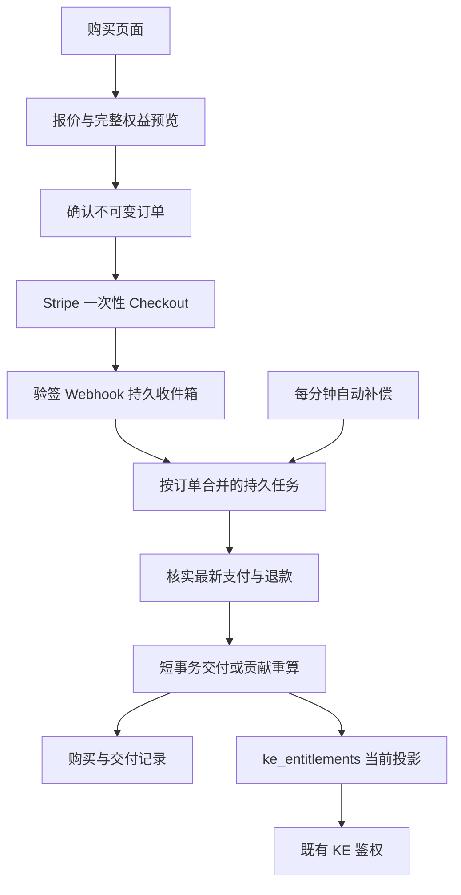

# LTSD：Stripe 购买、交付与自动退款设计

日期：2026-10-30

状态：业务规则已讨论确认；整套技术设计已完成独立可实施性审阅，待用户审阅后另行编写实施计划。

范围：设计订单、计价、Stripe 收款、权益交付、购买记录、自动退款与自动补偿；本阶段不部署、不创建正式 Stripe 商品。

## 1. 目标与边界

用户能够明确知道买了几个实例额度、买了多少使用时间、开通了什么功能，以及付款前后账号所有权益的到期变化。

沿用现有 Cloudflare Worker + Hono、MySQL 8/mysql2/Hyperdrive、Vite/TypeScript，不重做 KE 鉴权，不引入订阅自动扣款。Stripe 负责一次性收款，LTSD 负责权益期限。购买、交付、退款回收和失败重试均自动执行，没有“部分退款等待人工选择权益”的业务分支。

现有审核用 VIP 页的套餐和文案不是需求依据；现有捐款 Payment Link 和捐款榜保持独立。

不引入“已过期额度列表”或“恢复过期项目”。运行时仍只查询当前生效权益。订单历史和交付历史可以长期保留，但不会把失效历史记录重新展示成可续期商品。

## 2. 已确认的业务规则

### 2.1 商品与期限

| 商品 | 权益资源 | 原价 | 计量 |
| --- | --- | --- | --- |
| KE 实例额度 | slots | CNY 50 / 个 / 30 天 | 数量 × 时长 |
| 全平台离线 KoreEngine | module:standalone | CNY 30 / 账号 / 30 天 | 账号功能时长 |

功能与额度独立。离线功能有效期间，账号所有有权运行的实例均可使用该功能，不按实例数再次收费。

每个正式用户赠送的 1 个 99 年额度，以及赠送核心模块，不作为收费项目。赠送额度通过现有来源识别：resource=slots、source=signup、source_ref=email-verified:slots。不能仅凭“有效期很长”推断赠送来源。

一个月固定 30×24 小时；6 个月 180 天；12 个月 360 天。界面写明天数，避免把 360 天表达为 365 天。

| 单个项目本次新增时长 | 期限优惠 |
| --- | --- |
| 不足 180 天 | 原价 |
| 满 180 天、不足 360 天 | 8 折 |
| 满 360 天 | 7 折；更长时长沿用 7 折 |

优惠适用于该项目本次新增的全部时长；不合并不同额度的天数，不把历史剩余时间计入优惠门槛。普通加购、续期、统一到期补差使用同一规则。

常用期限总价：

| 商品 | 30 天 | 90 天 | 180 天 | 360 天 |
| --- | ---: | ---: | ---: | ---: |
| 每个额度 | ¥50 | ¥150 | ¥240 | ¥420 |
| 离线功能 | ¥30 | ¥90 | ¥144 | ¥252 |

分段按钮优先提供上述常用期限。后端以整数月数表达普通购买时长，内部统一转换为整数毫秒；任意整月的支持不需要额外创建 Product。

### 2.2 加购、续期与统一到期

- 加购额度：增加新的独立额度，每个额度对应一个可单独续期的逻辑单元。
- 续期：逐个选择当前有效的非赠送额度；同日到期也不合并、不使用组内数量下拉。只有赠送额度时，没有可续费额度，拒绝空的额度续期请求。
- 功能：没有有效功能时开通；已有有效功能时顺延。同一功能的多笔购买最终累计使用时间，不能建立互相重叠的授权而使 60 天付款只产生 30 天使用时间。
- 统一到期：包含账号当前有效的可收费额度和已开通付费功能，排除赠送额度、核心模块及负数调整记录。
- 统一目标时刻 T = 当前最晚收费项目到期时刻 + 所选新增期限。
- 每项购买的补足时长 D_i = T - 该项目当前到期时刻。
- 若最晚与最早到期时刻相差不足 24 小时，点击统一到期只弹出“已基本一致，无需统一到期，请普通续期”的提示，不生成付款订单。
- 统一到期订单至少有一项补足时长超过 30 天。现有判定结合最短 30 天期限自然满足该条件；仍在服务端显式验证。

例：付费额度剩 15、20 天，离线功能剩 3 天，选择新增 30 天；统一目标为当前时刻后 50 天，购买时长分别为 35、30、47 天。

### 2.3 固定订单与完整交付

用户确认后，订单的商品、数量、目标、购买时长、价格、优惠选择、币种和下单预览永久固定。支付状态、交付结果和退款记录可以变化，它们不是修改购买内容。

允许同一账号多笔待支付订单并存；返回或编辑页面不修改、关闭旧订单。每个订单拥有独立的 30 分钟 Checkout 付款窗口，展示精确截止时间并按 Stripe 返回的 expires_at 判断；不重建会话给旧单续时。

每笔成功支付订单必须完整交付其固定的新增时长。若其他订单改变权益，旧统一到期订单也按原新增时长追加，允许最终日期不再一致。不能为了强制对齐而少发已付款时间。

例如 A/B 原剩 15/20 天，统一订单购买 35/30 天；期间另一单给 A 增加 30 天，再支付旧统一单，最终 A/B 为基准时刻后 80/50 天，属于正确结果。

起算：

- 新额度和首次功能开通：从实际交付成功的时刻起算。
- 续期：new_end = max(latest_end, delivered_at) + purchased_duration。
- 支付通知延迟不吞掉购买时长。
- 固定订单保存下单时预计日期；不可变交付记录保存实际交付前后日期。

### 2.4 计费精度、促销码与时区

权益期限和新增时长使用整数毫秒。费用按实际时长比例计算，每个收费单元四舍五入到分，再相加。中间计算用 BigInt/整数有理数，不用浮点累计：

    raw_cents_i = round_half_up(monthly_cents_i * duration_ms_i / month_ms)
    tier_cents_i = round_half_up(monthly_cents_i * duration_ms_i * tier_percent_i / (month_ms * 100))

期限优惠直接从未舍入的基础有理数计算，避免先把日价舍入。35 天 12 小时的额度原价为 ¥59.17。

促销码在 Stripe 生成管理，在 LTSD 下单预览输入和核验。比较两笔整单价格：

- A：逐项期限优惠后相加。
- B：各项原价，加上 Stripe 促销码及其适用范围后的整单价格。

整单选较低者，不逐项混搭、不叠加优惠。平价时保留期限优惠，不兑换促销码（实现选择）。促销码的有效期、限次、客户限定、首单限定、最低金额、商品范围及币种都要验证；原生兑换仍由 Stripe 执行。

页面所有日期由用户当前浏览器本地时区展示，标注所用时区；服务器时间戳和固定时长不受浏览器时区、夏令时变化影响。不得固定北京时间。

### 2.5 全自动退款

默认不提供用户主动申请退款入口。外部退款成功后：

    r = cumulative_successful_refund_cents / original_paid_cents
    target_reversed_ms_i = floor(original_delivered_ms_i * r)
    delta_reversed_ms_i = target_reversed_ms_i - already_reversed_ms_i

比例上限 100%，分母为优惠后原始实付总额。每个订单项原始新增时长分别乘同一比例，不按账号当前总剩余时间缩放。累计目标差额使分次退款与一次退款结果一致；100% 退款精确撤销本单全部贡献。

例：订单实付 ¥180，额度 90 天 + 离线 30 天。退 ¥36 时分别回收 18/6 天；再退 ¥18 时额外回收 9/3 天。其他订单的时长、赠送权益不受影响。

退款处理中、失败或取消不作为成功退款；若真实退款状态从成功转为失败，自动按最新累计成功金额恢复对应贡献。恢复是重算原有贡献，不按当前时刻重新赠送完整期限。

## 3. 当前代码与接入约束

已核实：

- [权益查询](../../../apps/worker/src/ke/entitlements.ts)按 starts_at <= now < expires_at、revoked_at IS NULL 聚合 resource/quantity；模块总和大于 0 才有效。
- [现有表](../../../migrations/mysql/017_ke_entitlements.sql)支持签名数量、有效窗口、来源唯一键、撤销标记，且禁止 quantity=0 或 expires_at<=starts_at。
- [管理员编辑](../../../apps/worker/src/admin/service.ts)已经支持修改 expires_at/revoked_at，在同一事务写 before/after 审计。迁移注释“只追加”与实际编辑行为不一致，实施时只修正相关约定，不重做鉴权。
- [MySQL 客户端](../../../apps/worker/src/db/mysql-client.ts)具备事务；[Worker 入口](../../../apps/worker/src/index.ts)会在每次请求结束关闭本次数据库。
- [现有定时任务](../../../wrangler.toml)已有每分钟触发，且账号任务与快照任务存在独立失败处理。
- [现有 Stripe 模块](../../../apps/worker/src/domain/stripe.ts)仅用于捐款榜读取，不可当成购买交付系统。

因此：ke_entitlements 继续是当前权益投影；新增商务记录作为订单、贡献和回退依据。授权代码无需改成读订单。付款后的异步任务不得借用已经被请求 finally 关闭的连接，必须自己创建并关闭数据库。

## 4. 系统结构

第一版沿用 MySQL 持久任务和现有 cron，不增加新的 Queue、Durable Object 或独立订单服务。waitUntil 只是加速唤醒，不是任务存储；被终止后仍由数据库任务和 cron 自动继续。

模块建议放在 apps/worker/src/commerce/，分为 catalog、pricing、quote、orders、stripe-client、fulfillment、refunds、projection、jobs、repository、router。前端新增独立购买及订单页面，复用现有登录状态和导航；不沿用假 VIP 套餐逻辑。

## 5. Stripe 接入

### 5.1 商品及配置

配置两个 Product：KE 实例额度、全平台离线 KoreEngine 功能。常用期限可创建 CNY 一次性 Price；任意整月、按时间补差使用关联已有 Product 的 inline price_data。

本设计不创建正式商品。实施及联调先用隔离测试环境、测试数据库及测试 Webhook；正式账号和测试模式不可混用，订单与事件都保存 stripe_account_id、livemode。

已读取 LTSD.Ro 正式账号：普通商户默认配置 Alipay available=true、显示开启；另一个应用管理配置不提供 Alipay。配置 COMMERCE_STRIPE_PAYMENT_METHOD_CONFIGURATION 指向普通商户配置，上线核验它仍支持 Alipay。

Checkout 必须：

- mode=payment、托管收银页，CNY。
- managed_payments.enabled=false，不接受来自前端的覆盖。
- adaptive_pricing.enabled=false，避免冻结订单币种/金额发生兑换变化。
- allow_promotion_codes=false；优惠已在 LTSD 整单择优。
- 促销胜出才传原价项目与 discounts.promotion_code；期限胜出传期限价且无 Stripe discount。
- 关闭自动恢复新 Session；同一订单一个 Session，重试使用固定幂等键。
- 显式关联 customer、client_reference_id、Session metadata 与 payment_intent_data.metadata 中的 order_id/namespace。
- payment_method_configuration 使用普通商户配置；采用动态支付方式，不硬编码仅信用卡，不传 payment_method_types。
- 不自动启用 Stripe Tax、额外税费或其他未确认的附加费用。Managed Payments 与商户自身税务责任是独立事项，本设计不作税务结论。

实施时锁定经过契约测试的稳定 API/SDK 版本，不直接把 MCP 的 preview 版本当成线上版本。integration_identifier 使用固定业务前缀和随机后缀，按所选稳定 API 的支持情况设置。

### 5.2 促销码的准确报价

使用 Stripe 的 one-time Invoice Preview 计算原价项目 + 原生促销码的价格，不创建真实 Invoice、不付款。只传本订单完整且确定的项目，使用与 Checkout 相同的 Product、单价、数量、币种、客户和折扣。

客户由 commerce_customers 按 LTSD user_id 唯一映射，不按邮箱寻找或复用捐款客户。校验预览明细没有非本单项目、订阅账项、税额或旧客户余额影响；取商品总价，不把客户余额抵扣后的 amount_due 当成商品价。

本地期限价格 A 与原生预览价格 B 比较后，保存全部报价明细及 Stripe preview 标识。Stripe 限次资格在真正创建 Checkout 时还会校验；如两阶段间促销失效或实际金额不一致，订单不能被静默改价，也不能发出不同金额的付款链接。旧订单记录 checkout_failed，页面自动刷新新报价，仍由用户确认新的固定订单。

促销不更便宜时不把该码应用到 Checkout。正常未兑换的报价不应消耗兑换次数；这一点以及金额舍入与 Checkout 一致性必须在测试环境验证。

为控制 Stripe 的行数，只有 Product、原价/所选价、时长、展示语义完全相同的收费单元可以合并为 quantity=N 的收款行。LTSD 内部仍逐个记录，不合并权益。原生促销报价与 Checkout 必须使用相同分组；原生整单折扣按确定的最大余数法分摊到购买记录项目，项目分摊金额之和等于实付总额。退款比例仍按整单实付总额。

## 6. 数据模型

以下是逻辑字段约束，实施 migration 可按已有命名和 SQL 风格细化。金额为整数分；时间、时长为 BIGINT 毫秒；API 的 BIGINT ID 以字符串传输。会产生乘法/除法的金额和时长计算使用 BigInt。

| 表 | 用途与关键约束 |
| --- | --- |
| commerce_customers | user_id + Stripe 账号/模式唯一；stripe_customer_id 唯一；仅保存支付客户映射 |
| commerce_quotes | 不可变的短期报价、完整前后预览、输入摘要、报价版本、用户和截止时间；用于确认前核对，不是订单 |
| commerce_orders | 固定商业快照、金额、优惠、预览、created_at、Stripe 关联；另存可变化的 checkout/payment/fulfillment/refund 状态 |
| commerce_order_items | 每个额度一个单元；功能一个单元；resource、操作类型、目标 unit_ref、duration_ms、原价/期限价/分摊实付、预计日期；订单建立后不可改 |
| commerce_units | 稳定 unit_id、user_id/resource、ke_entitlement_id、来源/基线、legacy_origin_id/ordinal、独立管理员撤销标记；首次交付已全退且无基线时 projection ID 可为空；一条当前投影可关联多次订单贡献 |
| commerce_unit_events | 不可变贡献与审计：初次/续期交付、管理员期限调整、退款重算结果；含 unit_seq、order_item_id、实际 before/after、occurred_at、delivered_at、duration_ms、dedupe_key；管理员事件必须保留发生时刻 |
| commerce_refunds | Stripe refund_id 唯一；订单、金额、币种、最新核实状态；不以每个 Webhook 的金额重复相加 |
| commerce_provider_events | Stripe 账号/模式/event_id 唯一；已验签事件类型、对象 ID、订单关联、接收时间与摘要；作为持久收件箱 |
| commerce_jobs | 按订单合并核对任务；唯一任务键、dirty_generation、processed_generation、next_run_at、lease_owner/until、fencing_token、attempts、last_error_code |

订单固定字段至少包括：user_id、currency、items_snapshot、pricing_version、raw_total_cents、tier_total_cents、promo_total_cents、paid_total_cents、discount_strategy、promotion_snapshot、preview_snapshot、confirmation_idempotency_key/request_hash。

退款核对额外保存 refund_snapshot_hash、refund_revision、applied_refund_revision。每次权威退款对象集合发生真实变化就递增 revision；重算审计按 order_item_id + refund_revision 去重，不能以“累计退款金额”作唯一键，因为成功/失败变化后同一累计金额可能再次出现。

订单状态分别记录，避免一个 enum 丢失事实：

- checkout_state：creating / ready / failed / expired。
- payment_state：unpaid / processing / paid。
- fulfillment_state：pending / fulfilled；已全额退款且未交付的订单也记录“已结清、无净权益发放”。
- refund_state：none / partial / full，从累计成功退款金额派生。

唯一约束：

- 订单创建：(user_id, confirmation_idempotency_key)，重复 key 的输入摘要必须一致。
- Stripe Session、PaymentIntent、Charge 均按账号/模式建立唯一关联。
- 每个 order_item 仅有一个原始 PURCHASE 贡献事件，dedupe_key 唯一。
- units 的 ke_entitlement_id 唯一；legacy origin + ordinal 唯一。
- refund_id、event_id 分别去重；不同事件可指向同一个退款。
- 财务订单及其贡献不可随日常账号清理级联删除；现有并无用户硬删除接口，本次使用 RESTRICT 并在未来账号删除设计中另行处理。

按 user_id/created_at/id 建购买记录游标索引；按 user_id/resource 建单元索引；按 unit_id/unit_seq 建重放索引；按 next_run_at、lease_until 建任务领取索引。所有后台扫描有索引、LIMIT 和持久游标。

## 7. 权益单元与旧数据

### 7.1 新购买

新买 N 个额度，建立 N 个 quantity=1 的 ke_entitlements 投影和 commerce_units。新商业投影 source=commerce、source_ref=unit:<unit_id>，不是每次续期一个 source_ref。这样同一投影可以被多次订单顺延，订单归属由贡献事件记录。

赠送额度不转为 commerce unit、不修改其期限；核心模块不销售。

### 7.2 已有多数量记录

旧的正数 slots 行可能 quantity>1。只在用户首次为该行请求商务报价时，按账号锁进行一次原子规范化：

1. 读取原行，验证归属、时间窗口、来源和数量。signup 赠送行、负数行不能拆分。
2. 为每个 ordinal 创建独立 unit 与 quantity=1 子投影，完整保留原有效窗口和来源基线。
3. 子投影写完后撤销父投影；原 quantity 保留作历史，不能写 0。
4. 同一事务校验原始 signed resource totals 和 queryEntitlements 的结果均未改变。
5. legacy:<parent_id>:<ordinal> 可解析到新 unit_id，因此旧页面和已确认订单的目标引用仍可使用。

规范化仅改变存储粒度，不产生购买、延长时长或增减总额度。管理员历史界面标记被拆分父行；禁止将已拆分父行直接取消撤销而重复发放，提示编辑对应子额度。该保护只针对内部拆分父行，其余既有编辑保持原行为。

quantity=1 的旧额度可原位关联基线。无法证明历史购买的旧记录不伪造历史订单，标注“已有权益”。

旧 standalone 的规则如下，不能把多条旧授权合并成一条而改变 signed SUM：

- 保留所有旧正向/负向行、数量和有效窗口，不统一撤销或合并。
- 功能是一个账号级商品，但可以保留多个已有物理基线。报价的续期基线取所有当前有效、未撤销的正向 module:standalone 行中 expires_at 最大者；相同时取最小 id。最近创建不代表最晚到期。
- 该目标首次被购买影响时原位接管为一个 commerce_unit，基线保留该行原始 quantity（可能大于 1），不按数量销售多份功能。
- 功能订单不可变目标是 user_id + resource；quoted_anchor_ref 仅保存下单预览依据。实际 unit 绑定记录在交付事件中。交付时再次按相同“最晚到期、最小id”规则解析当前基线并追加全部固定时长。
- 没有当前有效正向基线时，新建 quantity=1 功能投影，从实际交付时刻开始。其他开通订单先交付后，新一单会选中它并继续顺延。
- 负数限制继续由原 signed SUM 决定，不能通过购买或合并绕过。预览显示该限制及当前可用结果；它不是额外的付费功能。核心模块仍不参与销售。

因此无须强制“整个账号的功能永远只有一条物理记录”。普通无旧数据的商业路径会自然复用同一单元；旧数据和管理员独立授权保持原有语义。

现有负数调整行继续参与原鉴权聚合，但不参与购买、计价或对齐目标。完整预览保留只读“额度调整”及其有效期，汇总严格使用 queryEntitlements；不能把正向行数量误称为当前净可用额度。starts_at>now 的旧授权按原规则不纳入当前有效购买目标，不为它新增管理入口；本系统不靠未来追加行实现普通续期。

### 7.3 当前投影与管理员修改

普通续期更新对应行的有效窗口，不新增相互重叠的商业授权。基线与贡献保存在 commerce_units/events，购买记录不依赖当前行逆推。

管理员对已接管单元的期限编辑，必须在同一账号锁和事务内记录原始 before/after、发生时刻、有效期限差额及独立管理员撤销状态，并继续写现有 admin audit。退款重算保留这类非订单调整，不覆盖管理员撤销。内部因本单全额退款造成的无权益，与管理员主动撤销分开记录，避免退款失败恢复时解除管理员禁用。

期限编辑在当时仍严格执行管理员指定的绝对目标时间。不能简单用 new_end-old_end 作为未来重放的独立时长，因为 old_end 可能早于操作时刻：

- requested_end > occurred_at 时，记录 effective_delta_ms = requested_end - max(before_end, occurred_at)。这是从管理员操作时刻看真正新增或减少的有效时间；同时保留原始绝对 before/after 供审计。
- 正有效差额在重放时延长尚连续的窗口；若此前没有窗口或窗口已结束，从管理员事件 occurred_at 起建立该差额时长的窗口。
- 负有效差额只缩短当时窗口，最多清空，不形成后来新购买的时间欠额；零差额不产生独立赠送。
- requested_end <= occurred_at 时，记录 ADMIN_CUTOFF 事件，终止该时刻之前的当前窗口，保留管理员指定的历史结束时间快照，不产生未来欠额或独立正时长；之后新购买照常给满。投影已无窗口时，可以保留该合法历史窗口并标记内部不可用，不写违反表 CHECK 的起止值。

例如旧窗口第30天结束，第100天管理员设到第130天，有效正差额是30天，重放得到第130天，不能按原始差额100天重放到第200天。这是保留既有绝对期限编辑、独立管理员赠送与“新购买必须给满”的实现选择。

## 8. 交付与自动退款重算

### 8.1 原始交付

固定顺序获取锁：auth_users 的用户行 → 本订单 → 按稳定顺序排列的 units → 对应权益行。管理员涉及商务单元的编辑也遵守该顺序。

Stripe 网络请求在事务外，持久任务获得单订单租约后核对；数据库事务内不等第三方网络。

确认付款后，事务内：

1. 校验任务 fencing_token、用户/订单/币种/实付/Stripe 关联；确认尚未处理的 order_item。
2. 新额度创建独立单元。续期锁定订单目标，不因页面后来变动重选目标。
3. 功能开通目标为“此用户的此 resource”。若其他开通订单已经先交付，解析到最新对应有效功能并顺延；不产生仅布尔合并的重叠授权。
4. 取成功交付时刻，记录 purchased_duration、delivery_seq 和实际 before/after，按完整时长生成投影。
5. 同时纳入已经确认的退款，应用净贡献；更新交付状态与任务进度，整体提交。

订单项 PURCHASE 唯一约束、订单锁及事务保证“付款交付一次”；不能只依赖 event_id，因为同一付款可以产生不同 Stripe 事件。

投影提交后，新的鉴权查询使用更新后的权益；已签发客户端许可证沿用现有续签和到期策略。本次不改许可证协议、不承诺对离线客户端即时远程撤销，不能把订单交付接口当作新的客户端鉴权入口。

### 8.2 为何退款不能直接还原旧日期

同一额度先后续期 A、B，退款 A 时直接恢复 A 的 before 日期会抹掉 B。仅从当前期限机械减去天数也不能正确处理两次交付之间的间隔、首次购买退款或管理员编辑。

采用有序贡献重放，ke_entitlements 仍只存最终当前投影。它不是新的鉴权系统。

### 8.3 确定的重放算法

单元保留不可变已有权益基线；每个 PURCHASE 事件保留 delivered_at、原始 duration_ms。按 unit_seq 重放：

1. 根据本订单最新累计成功退款比例，算出该 PURCHASE 的 retained_ms。
2. retained_ms=0 的购买不贡献时间，不推进窗口，不重新起算。
3. retained_ms>0 时：若没有窗口，或事件交付时刻已超过前一窗口结束，开启从该 delivered_at 起的新连续窗口；否则从当前窗口结束继续顺延 retained_ms。
4. 管理员事件使用第7.3节的 effective_delta_ms，不用原始绝对日期之差。正差额延长连续窗口，或从 occurred_at 开新窗口；负差额最多清空当时窗口，不扣后来的新购买。ADMIN_CUTOFF 形成该时刻的截止屏障，不产生未来时间欠额。管理员撤销状态独立保留。重算不编辑既有事件。
5. 只物化最后的连续窗口；若它自然已不生效，仍由现有 SQL 忽略，无需“过期项目”业务流程。完全无窗口时使用内部撤销状态，不写无效的 expires_at<=starts_at。

退款时在用户锁下更新权威退款记录，计算累计目标抵扣并重放受影响单元，写不可变 REFUND_REPROJECT 事件，保存实际 before/after 和抵扣差额。原始交付记录不改写。

返还退款导致 retained_ms 增加时，重放同一历史贡献；不会从今天重新发放一个完整期限。0 实付订单没有可发生的正金额退款，显式避免除零。

管理员边界例：第0天购买30天，第5天管理员独立增加30天。购买全退后，保留从第5天到第35天的管理员30天贡献。旧窗口第30天已结束，第100天管理员设到130天，重放始终得到130天；管理员设到已经过去的50天时，该事件只是截止屏障，之后新付款仍从其交付时刻获得完整购买时长。

### 8.4 退款乱序与先于交付

- Webhook 只触发核对，不直接用其旧快照覆盖最新退款状态。
- 一个订单同一时刻只有一个核对租约；租约过期的新处理者增加 fencing_token，旧处理者不能提交。
- 按 refund_id 更新最新 Stripe 状态，累计仅统计 succeeded；所有分页读完后才完成一次完整状态核对。超过单轮预算则持久化游标继续。
- 核对期间若又收到事件，dirty_generation 增加；本轮完成后仍有下一轮，不吞掉新事件。
- 多次金额变化用累计目标差额，不重复执行历史抵扣。真实退款失败可导致负差额，自动恢复对应原始贡献。
- 退款先到时，订单仍保存原始完整购买，但交付事务直接物化净权益；100% 已退则不短暂发出完整授权。

普通退款与临时争议不是同一事件。临时 dispute 不当成成功退款；自动跟踪其结果。若最终确认本金被撤回，则按实际本金撤回比例套用同一贡献抵扣机制；恢复本金时恢复原贡献，不按费用扣时长。退款和撤回重叠部分必须按 Stripe 真实本金流向去重、总比例封顶 100%，不把手续费计入用户退款额。相关契约测试属于上线门槛。

## 9. 订单与后台任务时序

### 9.1 报价和建单

1. 服务端鉴权，读取当前有效权益，解析可续单元，报价使用同一时刻快照；统一到期目标在此冻结。
2. 规范化需要逐个续期的旧多数量记录；只要数量/窗口未变，允许重新生成同样业务结果的快照。
3. 按 catalog/pricing_version 计算期限报价；有 code 时调用原生预览；保存短期 quote（初始 2 分钟，实现选择）。
4. 返回全量权益前后预览、所有收费明细、价格选择原因、预览生成时间。明确“其他订单后来付款时，也会完整累计时长”。
5. 用户确认后以 idempotency key 建固定订单；过期 quote 在创建订单之前自动刷新并要求重新确认，不修改已经成立的订单。
6. 使用固定 provider 幂等键创建一个 Checkout；保存 Stripe 返回的金额/币种/Session/期限后才向浏览器返回 URL。
7. 若创建响应丢失，后台用相同幂等键恢复同一 Session，不重复创建。若超出 provider 幂等保留窗口，先按 order metadata 和时间范围核对已有会话，不能无条件用旧 key 再创建。

付款窗口以实际会话就绪和 provider expires_at 为准，目标 30 分钟；临界时钟误差由适配器按所选 API 的最短会话限制自动重试，精确截止时间在会话就绪后固定。创建会话失败、促销失效、金额不符不会偷偷更改固定订单；页面可重新报价后确认另一单。

统一到期操作为独立订单模式，包含全部当前收费项目，不同时混入尚未加购的新额度（实现选择）。普通模式支持额度加购、选定额度续期、功能购买组成混合订单。同一单元在一单里只能出现一次，拒绝隐式重复续期。

### 9.2 收件、核对与补偿

Webhook 原始字节验签后，持久保存 event_id/类型/对象/账号模式/摘要，并合并订单任务。数据库不可用返回非 2xx 让 Stripe 重试；持久入库成功即可 2xx，之后的错误由任务继续。

加速唤醒用独立连接的 waitUntil 任务；每分钟 cron 独立执行商务 tick，不能被账号邮件或市场快照任务失败阻止。租约、退避、分页和下一次运行时间都在 MySQL；进程内变量不承担幂等或恢复状态。

初始运行选择：每轮最多处理 20 个就绪订单、最多 20 秒；单个外部请求设超时；任务租约 60 秒，长分页可续租。退避 5 秒、30 秒、2 分钟、10 分钟，之后最高 1 小时继续自动重试，不因达到固定重试次数改成人工业务状态。

所有已付款订单纳入 next_reconcile_at 有索引的轮转核对，近期热订单频繁，稳定历史订单逐步降至每日；即使退款 Webhook 完全漏收，也可自动发现。处理量和间隔为实现初值，监控积压后调整，不做无界大表扫描。

### 9.3 事件与过期状态

- checkout.session.completed、checkout.session.async_payment_succeeded：触发权威核对，仅确认 paid 才发放；零金额单要求 complete 且 no_payment_required。
- checkout.session.async_payment_failed、checkout.session.expired：更新支付流程事实，不发放未付权益。
- refund.created、refund.updated、refund.failed、charge.refunded：核对对应订单与最新退款对象，不按事件次数相加。
- 支付失败后如仍是同一有效 Session，可回到该单继续支付；过期后新建订单，旧单保留历史。
- 已进入 processing 的支付可能在会话窗口之后才确认。不能仅根据本地时间或过期通知把后到的真实付款丢掉；确认已收款则完整交付。
- 与捐款或其他命名空间无关的 Stripe 事件记录忽略原因，不触发权益变更。

## 10. API 与界面契约

catalog 可以匿名只读；其余用户接口复用现有 session、ACTIVE 账号校验和写操作 Origin/CSRF；服务端自行确定 user_id。金额、duration_ms、折扣和到期时间不能信任前端提交值。响应 no-store。

| 接口 | 用途 |
| --- | --- |
| GET /api/v1/commerce/catalog | 商品、常用期限、当前价格版本 |
| GET /api/v1/commerce/entitlements | 当前净权益、逐个正向额度、功能、赠送和只读调整明细 |
| POST /api/v1/commerce/quotes | 输入购买动作、目标单元、月数和可选 code；返回权威报价与完整前后预览 |
| POST /api/v1/commerce/orders | quote_id + confirmation idempotency key；创建固定订单 |
| GET /api/v1/commerce/orders/:id | 本人订单、Session URL、支付/交付/退款状态 |
| POST /api/v1/commerce/orders/:id/refresh | 有限频率唤醒自动核对，不重复交付 |
| GET /api/v1/commerce/orders | 按 created_at/id 游标分页购买记录 |
| POST /api/v1/commerce/stripe/webhook | Stripe 验签入口，不使用浏览器 CSRF 代替验签 |

写入 JSON 采用白名单字段和有界请求体；月数必须为正整数，写库前检查时长、时间戳和金额的安全整数/数据库/provider 范围，超限明确拒绝，不能截断。初始安全上限选择每单 1000 个额度单元，超过在付款前明确提示分单，不截断后悄悄收费；不限制账号总额度。完整权益预览按稳定游标逐项可浏览全部记录，显示总数量；不合并同日额度、不只展示购买项。Stripe 收款行上限按所选稳定版本校验。

错误至少区分：无可续权益、目标不属本人、目标赠送不可续、无需统一到期、报价已过期、促销不可用、会话创建失败、金额核验失败、账号未激活、系统暂不可用。错误不暴露他人订单、密钥、SQL 或支付客户私密字段。

前端：

- 购买入口包含加购、逐个续期、功能开通/续期、统一到期。
- 续期选择常显分段期限和半年/12 个月优惠。
- 付款前列表包含赠送、所有额度、未变化项目、功能和必要的只读调整；显示原时间、新时间、增加天数/小时、费用、采用的整单优惠。
- 成功返回页显示支付与交付状态，自动轮询本人订单；浏览器返回不是交付触发器。
- 购买记录展示原始订单快照、实际交付前后、每次退款比例和扣减结果；状态文案包括待支付、处理中、已支付待发放、已完成、已超时、部分退款、全额退款。

## 11. 配置、迁移与运行

新增独立 COMMERCE_ENABLED、商务受限 Stripe API key、Webhook signing secret、两个 Product/常用 Price 映射、普通支付配置 ID、账号/模式及稳定 API 版本配置。复用既有 secret 部署机制，不复用捐款 key 扩权；不打印或提交密钥。

开关分工：

- COMMERCE_ENABLED 只控制新报价/新建单和购买入口。
- 已创建订单的 Webhook、核对、交付、退款任务必须继续运行；关闭销售不能停止已收款订单服务。
- AUTH_ENABLED 仍决定用户登录入口；后台商务处理不依赖某个用户 session。

新增 MySQL migration，仅增加商务表/索引；不重命名既有 resource、auth 字段或授权响应。旧数据逐个额度规范化在短事务按需执行，不进行无界生产回填。更新相关管理员接管操作、部署环境解析和配置渲染，核对 staging/production 不被脚本丢弃。

本轮只编写设计文档。实现顺序和任务拆分在此设计审阅后另写计划；后续先测试环境完成契约验证和故障测试，再配置正式 Product/Price、普通 Checkout、Webhook 与运行开关。创建正式商品由助手在确定的账号环境中执行，不能把测试 ID 当正式 ID。

## 12. 必须通过的验证场景

1. 6 个额度×30 天=¥300；1 个×180 天=¥240；2 个×90 天=¥300；离线功能费用与额度数无关。
2. 新增 179.999 天不享半年折扣，180 天享 8 折，360 天享 7 折；已有剩余不参与门槛。
3. 35/30/47 天补差为 ¥58.33/¥50/¥47，逐项之和 ¥155.33；35 天 12 小时额度原价 ¥59.17。
4. 赠送额度从所有收费及最晚目标日期计算中排除；只有赠送额度时拒绝额度续期。
5. 时差 0、23:59:59 提示无需统一，24:00:00 允许；不能强行少发已购时间。
6. 同日额度独立选择；旧 quantity=6 拆分前后鉴权相等；旧负数调整与赠送行不被拆分或收费。
7. 新购从实际交付时刻开始；同一单元两单各 30 天都付费后累计 60 天；旧统一单在其他单付款后也完整追加。
8. 两笔首次功能开通订单先后交付，累计 60 天；不是重叠两份 30 天。
9. 促销整单择优：额度360天+离线30天，期限价¥450、7.5折码价¥472.50，选¥450；6折码价¥378，选促销。不逐项混选、不在期限价上再用码。
10. 原生预览与最终 Checkout 的金额、币种、分组和促销限制一致；测试固定减免、商品限定、客户/首单/最低金额/限次及限次竞争。
11. 零金额有效促销仅在真实 complete/no_payment_required 时交付；退款比例不除零。
12. 点击重试、返回页重复刷新、不同支付成功事件、同事件重复送达均只交付一次。
13. 支付成功但页面未返回、进程提交后崩溃、数据库暂断、Session创建响应丢失、waitUntil被终止，均自动恢复且不双收/双发。
14. 退款20%再10%与一次30%结果相同；原始90/30天、实付¥180，退款¥36回收18/6天，再退¥18追加9/3天。
15. 退款通知先于付款通知、先于交付、多事件指向同一refund_id、通知乱序、退款失败恢复、全额退款等均自动一致。
16. A已续30天、B又续30天，退款A后保留B完整贡献；新购A被退且B后来续期，重放必须保留B从其实际交付时刻可得到的完整期限。
17. 管理员调整/撤销与支付、退款并发，不覆盖管理员状态、不突破锁顺序；拆分父记录不能被直接恢复造成双倍数量；“第0天买30天、第5天管理员加30天、原购买全退”保留第5至35天；“第30天已结束、第100天管理员设到130天”重放仍为130天；截止历史窗口和负调整不形成未来购时欠额。
18. 后台租约失效旧工作者不能提交；处理时有新事件不会丢任务；成功事务后确认响应丢失仍幂等。
19. 多笔待支付各自过期，互不关闭；真实后到付款不因本地expired而丢弃。
20. 浏览器不同时区及夏令时切换只改变显示；实际30×24小时、费用和订单内容一致。
21. 现有 KE 鉴权、管理员普通操作、捐款榜、市场及邮件/快照后台任务的相关回归测试通过。
22. 多条 standalone 正向/负向旧记录保持原 signed SUM；选择最晚到期基线、同期限取最小id；不合并旧物理行。另一开通单先付后，后付功能单仍完整顺延；退款仅重算实际绑定的单元。

正式验证采用仓库已有 Vitest/MySQL 集成框架，复用现有 MySQL 8 测试方式。文档查证不等于已运行 Stripe 契约测试，本轮不会宣称已验证正式支付或已上线。

## 13. 设计者作出的实现选择

以下是实现选择，不伪装为用户逐项提出的要求；不改变已确认的购买结果：

- MySQL 持久任务 + 现有每分钟 cron，waitUntil 独立连接加速。
- 正向旧批量权益按需原子拆分；新商业额度一条一个；现有聚合鉴权保持不变。
- 同一逻辑单元维护贡献账本，退款重放生成当前投影；不把订单 before 日期当作回滚指令。
- 报价初始 2 分钟有效；平价优惠保留期限价；统一模式独占该订单，不混入尚未加购的新额度。
- UI 首选30/90/180/360天分段按钮；每单1000单元是可调整的输入保护上限。
- 临时争议不当成退款，最终本金撤回才按同一贡献机制自动处理，手续费不扣用户时长。
- 管理员期限调整保存原始绝对 before/after 及以操作时刻为基准的有效差额；无窗口时的正差额从该时刻起算，负差额与截止事件不形成未来购时欠额。
- 旧功能授权不合并，按最晚到期的当前正向行接管续期，保留原数量和其他正负行；功能订单冻结账号/资源目标，实际投影绑定留在交付事件中。

## 14. 主要依据

- [Stripe Alipay 支持范围](https://docs.stripe.com/payments/alipay)：普通 Checkout 的 subscription/setup 模式不提供 Alipay；其他订阅能力需要邀请。
- [Products 与 Prices](https://docs.stripe.com/products-prices/how-products-and-prices-work)、[inline price](https://docs.stripe.com/products-prices/manage-prices)：一个 Product 可以有多个一次性价格。
- [Invoice Preview](https://docs.stripe.com/invoicing/preview)：可在不创建真实发票的情况下预览一次性项目及优惠。
- [Checkout 折扣与促销码](https://docs.stripe.com/payments/checkout/discounts)：原生促销限制和兑换；一次 Checkout 当前只接受一个 coupon/promotion code。
- [Checkout 交付](https://docs.stripe.com/checkout/fulfillment)：服务器确认支付后交付，不依赖成功页。
- [Stripe 退款](https://docs.stripe.com/refunds)、[Webhook](https://docs.stripe.com/webhooks)：核对真实退款状态，处理重复和乱序事件。
- [Cloudflare context.waitUntil](https://developers.cloudflare.com/workers/runtime-apis/context/#waituntil)、[Cron](https://developers.cloudflare.com/workers/configuration/cron-triggers/)：有限的响应后执行窗口与周期性后台任务，不能把内存唤醒当成持久任务。

Stripe 文档、账号只读配置和当前代码已核对；上述 API 的具体稳定版本、权限及报价一致性仍须在实施时用隔离测试环境验证。本设计不包含正式支付写操作、商品创建或生产数据修改。

独立审阅已检查订单不可变、多单完整交付、比例退款、旧数据兼容和后台连接生命周期。审阅提出的旧功能基线选择及管理员期限重放问题已补齐，复审结论为“nothing important left”。这代表可据此制定实施计划，不代表支付集成已经实现或通过线上测试。
